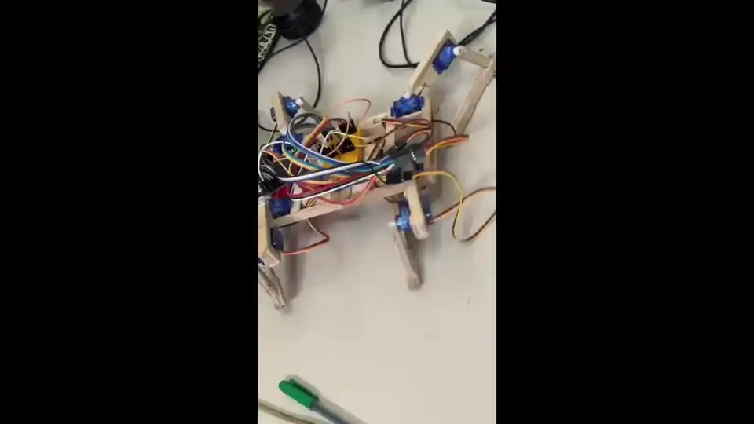

# Spider Robot — 8-DOF Quadruped

ESP32 / Arduino-controlled quadruped with a matching **MuJoCo** physics simulation.



## Demo

The animation above is converted from `demo.mp4`:

```bat
ffmpeg -y -i demo.mp4 -vf "fps=12,scale=960:-1:flags=lanczos" -c:v libwebp -lossless 0 -compression_level 6 -q:v 55 -loop 0 -an demo.webp
```

| File | Description |
|------|-------------|
| `demo.mp4` | Original demo recording |
| `demo.webp` | Animated WebP used in this README |

## Project layout

```
spider_robot/
├── README.md              ← this file
├── demo.mp4
├── demo.webp
├── sketch_sep26a.ino      ← ESP32 firmware (Wi-Fi stand/sit)
└── quadruped_mujoco/      ← Python + MuJoCo simulation
    ├── main.py
    ├── quadruped.xml
    ├── requirements.txt
    └── README.md
```

## MuJoCo simulation (Windows)

```bat
cd quadruped_mujoco
python -m venv .venv
.venv\Scripts\activate
pip install -r requirements.txt
python main.py
```

### Keyboard controls

| Key | Action |
|-----|--------|
| `↑` Up | Stand |
| `↓` Down | Sit |
| `←` Left | Move left rear leg |
| `→` Right | Move right rear leg |
| `R` | Reset to sitting |

Letter aliases: `S` stand, `D` sit, `L` left leg.

## Real robot (ESP32)

Flash `sketch_sep26a.ino` with the Arduino IDE (ESP32 board support).

- Creates Wi-Fi AP: **QUADRUPED-ESP32** / `12345678`
- Open `http://192.168.4.1` for stand / sit controls

### Joint map

| Name | Role | GPIO |
|------|------|------|
| leftup1 / leftup2 | Front left hip / knee | 14 / 16 |
| rightup1 / rightup2 | Front right hip / knee | 12 / 26 |
| leftdown1 / leftdown2 | Rear left hip / knee | 17 / 4 |
| rightdown1 / rightdown2 | Rear right hip / knee | 13 / 2 |

Simulation joint names match these so the same stand / sit / leg sequences can later drive both MuJoCo and the physical robot.

## More detail

See [`quadruped_mujoco/README.md`](quadruped_mujoco/README.md) for model dimensions, joint limits, and actuator tuning.
